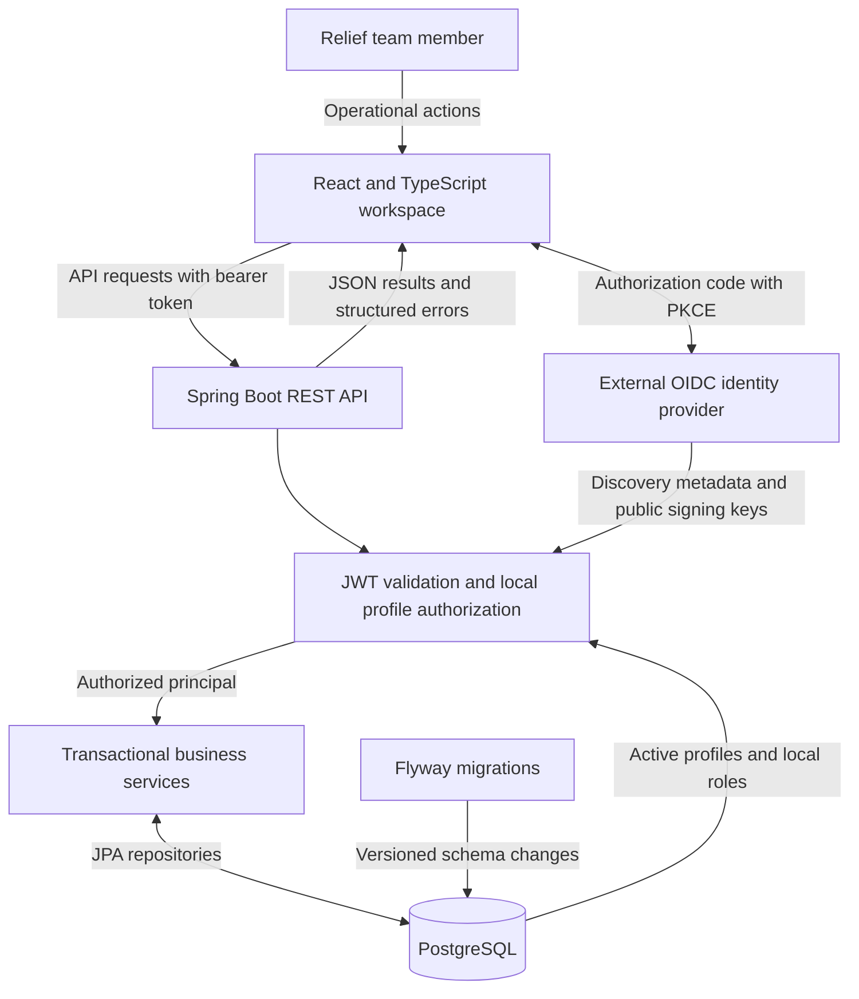
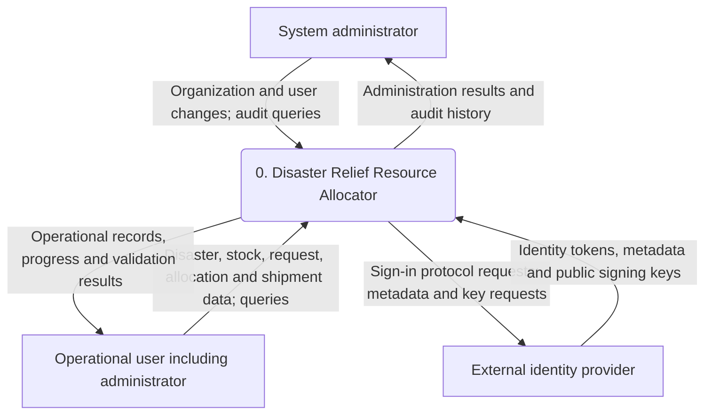
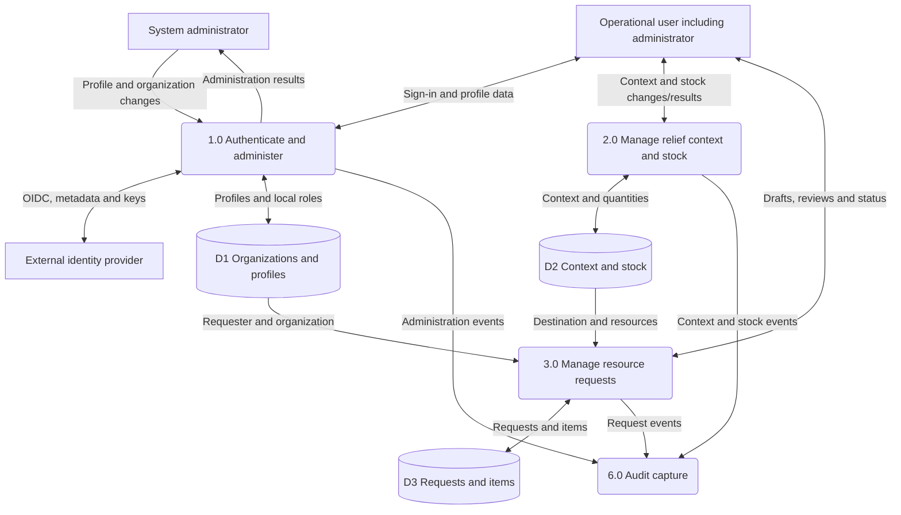
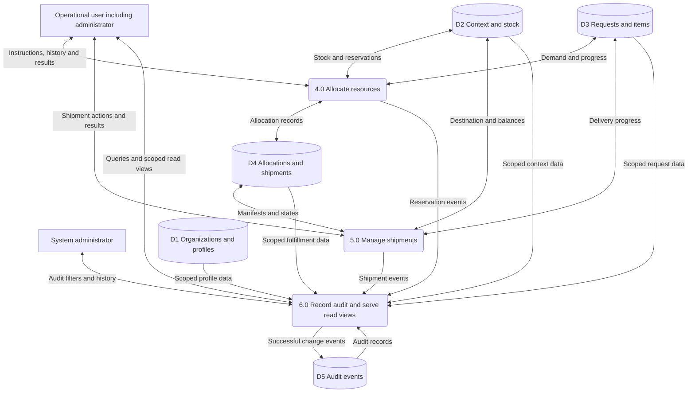
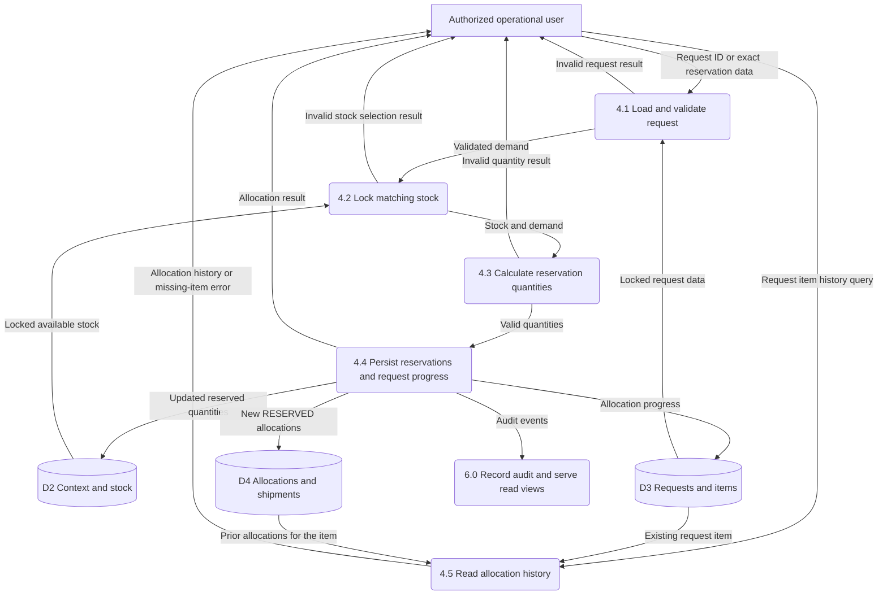
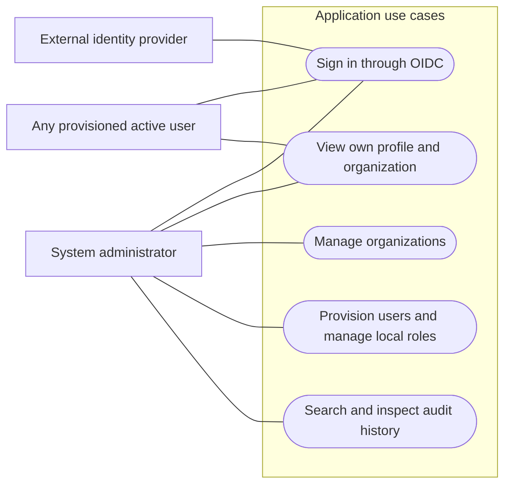
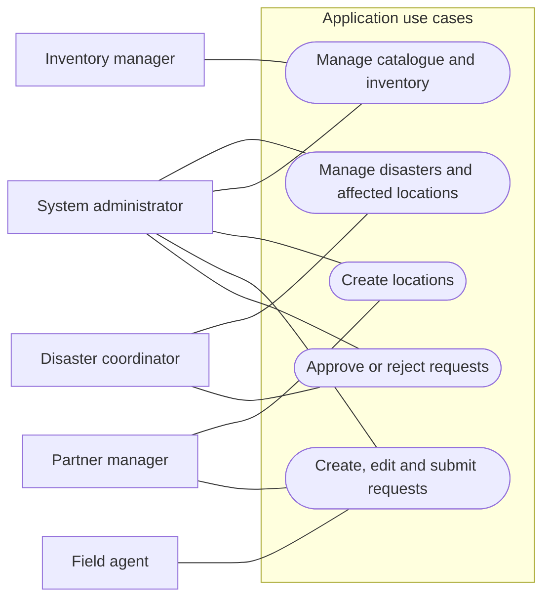
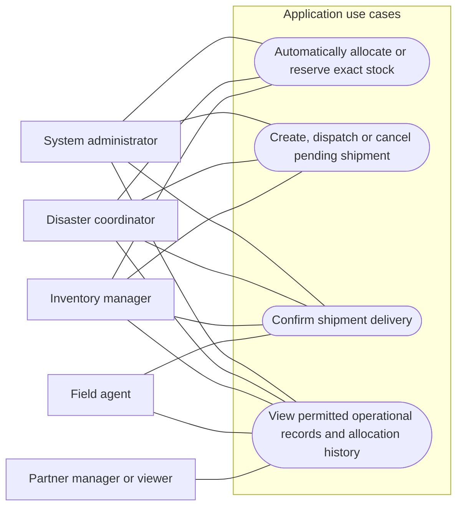

# Disaster Relief Resource Allocator

### From available supplies to confirmed delivery — one accountable relief workflow.

[](https://github.com/harsha160507/Disaster-relief-resource-allocator-/actions/workflows/ci.yml)


A full-stack disaster-response workspace that connects **organizations, affected locations, resource inventory, approved requests, allocations and shipments**. Built with a desktop-oriented React/TypeScript frontend and a Spring Boot backend, it helps relief teams answer three essential questions:

- **What do we have?** Track physical, reserved and available supplies.
- **Where is it needed?** Capture resource requests for disaster-affected destinations.
- **Has it arrived?** Follow commitments through dispatch and confirmed delivery.

**[Features](#key-features) · [Architecture](#system-architecture) · [Data flow diagrams](#data-flow-diagrams) · [Use cases](#use-case-diagrams) · [Getting started](#getting-started) · [Documentation](#documentation)**

## Why this project?

Relief operations need more than a list of supplies. They need a consistent connection between reported needs, warehouse stock, operational decisions and delivery records.

This project brings those records into one workflow. It reserves stock before shipment, distinguishes allocation from delivery, enforces organization boundaries and records successful changes with trusted actor attribution.

> **Core principle:** a supply commitment is not a delivery. Stock is reserved during allocation, deducted once at dispatch, and recorded as delivered only after receipt is confirmed.

## Key features

| Capability | What the system supports |
| --- | --- |
| Disaster coordination | Create, activate and close disasters; associate affected locations |
| Resource inventory | Maintain a shared resource catalogue; receive and adjust organization-owned stock |
| Request lifecycle | Create drafts, add resource items, submit, approve or reject requests |
| Allocation | Automatically reserve matching available stock or reserve an exact quantity; retain allocation history |
| Shipment management | Group reserved allocations by destination; create, dispatch, deliver or cancel before dispatch |
| Organization administration | Provision organizations and issuer-bound users; manage local roles and active status |
| Secure access | Validate provider-issued JWTs and enforce backend roles, ownership and organization scope |
| Audit history | Search administrator-only records of successful administrative and relief operations |
| Operational workspace | Dashboard and searchable, paginated tables with saved light/dark themes |
| Interactive demo | Explore sample workflows in a clearly labelled, in-memory environment |
| Automated delivery checks | Backend/frontend checks, PostgreSQL migration verification and source-identified release candidates |

### Roles and responsibilities

| Role | Main responsibilities |
| --- | --- |
| `SYSTEM_ADMIN` | Manage organizations/users and audit history; perform authorized operations across organizations |
| `DISASTER_COORDINATOR` | Manage disasters, review requests, allocate resources and manage shipments |
| `INVENTORY_MANAGER` | Manage resource types and stock, allocate resources and manage shipments |
| `FIELD_AGENT` | Create and submit own requests, view organization-scoped progress and confirm delivery |
| `PARTNER_MANAGER` | Create locations and manage organization-scoped requests |
| `VIEWER` | Read permitted organization-scoped operational records |

Roles are stored in local profiles. JWT role claims do not grant application permissions. Field agents can edit/submit only their own requests; partner managers can manage their organization's requests. Organization checks and lifecycle rules apply in addition to role checks.

## A relief operation in practice

1. **Prepare:** register an organization, provision its users, create locations and resource types, and record warehouse stock.
2. **Identify need:** create and activate a disaster, associate affected locations, and submit an itemized request.
3. **Review:** a coordinator or administrator approves or rejects the request.
4. **Allocate:** reserve matching stock from the same organization. Automatic allocation can satisfy part of a request when stock is limited.
5. **Ship:** group unassigned reservations for one destination into a shipment.
6. **Dispatch:** deduct physical and reserved quantities once.
7. **Confirm delivery:** update delivered quantities and request progress.
8. **Review history:** inspect allocation records and administrator-only audit events.

### Stock accounting that follows the workflow

**Available quantity = physical quantity − reserved quantity**

For a warehouse starting with **100 food kits** and a request for **60 kits**:

| Stage | Physical | Reserved | Available | Delivered to destination |
| --- | ---: | ---: | ---: | ---: |
| Stock received | 100 | 0 | 100 | 0 |
| Allocation reserved | 100 | 60 | 40 | 0 |
| Shipment created | 100 | 60 | 40 | 0 |
| Shipment dispatched | 40 | 0 | 40 | 0 |
| Delivery confirmed | 40 | 0 | 40 | 60 |

Cancelling a shipment **before dispatch** releases its reservations and allocated demand without deducting physical stock. Delivery does not deduct stock a second time.

`FULFILLED` means **fully allocated**; actual receipt is represented separately by `PARTIALLY_DELIVERED` and `DELIVERED`.

## System architecture



| Layer | Technology and responsibility |
| --- | --- |
| Frontend | React, TypeScript and Vite; operational screens, OIDC integration and demo workspace |
| API | Spring Boot Web MVC; controllers, validated DTOs and structured errors |
| Security | Spring Security OAuth2 resource server; token validation and local profile/organization authorization |
| Business logic | Transactional services for requests, allocation, inventory, shipments and administration |
| Persistence | Spring Data JPA/Hibernate, UUID identities, decimal quantities and concurrency controls |
| Database evolution | PostgreSQL and Flyway; Hibernate validates migrated entity mappings |
| Verification | H2 regression tests, real PostgreSQL integration checks and GitHub Actions |

## Data flow diagrams

These are **logical DFDs**, using Mermaid for GitHub-native rendering. Rectangles represent external entities, rounded nodes represent processes, cylinders represent logical data stores, and labelled arrows represent data. Store groups are tables within the same PostgreSQL database, not separate databases. Arrows describe information movement, not the movement of physical goods.

### Level 0 — system context

The entire application is one process. Relief staff includes coordinators, inventory managers, field agents, partner managers and viewers; each action is subject to that user's permissions.



### Level 1 — major application processes

**Level 1A — access, preparation and demand.**

The context process decomposes into six responsibilities, shown in two connected views. P2 groups disaster/location/catalogue and inventory operations; P6 groups read views and audit capture. Shared authorization applies before operational processes. Administrator operations use the same business processes with cross-organization scope where permitted.



**Level 1B — allocation, shipment and visibility.** P6 and D1–D3 are the same logical processes/stores referenced above; they are repeated for readability.



Administrators also participate through the operational-user entity. P6's audit writes occur **inside the originating business transaction**, not through an asynchronous event pipeline. An audit append failure rolls back the business change.

### Level 2 — decomposition of 4.0 Allocate resources

This view expands P4 while retaining its Level 1 boundaries: allocation instructions/results, stock, requests, allocations and audit events. Access checks happen at the HTTP boundary; services lock the request and inventory before changing quantities.



Automatic allocation reserves **min(remaining need, available stock)** from matching inventory in the destination's organization, ordered by inventory UUID. It can leave demand partially allocated. Exact reservations reject nonpositive quantities, mismatched resources, cross-organization stock, excess demand or insufficient availability. This is stock-matching allocation; the implementation does not optimize geographic routes or globally rank competing requests.

## Use case diagrams

These diagrams use **UML-style actor/use-case associations expressed as Mermaid flowcharts**: external rectangles are actors, oval nodes are use cases, and subgraphs define the application boundary. Associations show participation, not execution order. The views are split for readability.

### Administration and access



The application binds provider identities to local profiles; it does not issue passwords or provide public self-registration. Global administrators have no organization membership.

### Disaster, inventory and request operations



### Allocation, shipment and operational visibility



Operational reads remain subject to endpoint-specific permissions and organization scope. For example, inventory/catalogue APIs are restricted to administrators and inventory managers; membership does not grant unrestricted access to every dataset. The API permits coordinators and inventory managers to reserve exact quantities, although the current frontend exposes exact reservation to inventory managers.

## Security and consistency

- **Trusted identity:** JWT signature, issuer, audience and time claims are validated; each request reloads the active local profile and roles.
- **Organization isolation:** request destinations, requesters and allocated stock must have compatible organization ownership.
- **Concurrency protection:** transactions, row locks and entity versions protect stock and lifecycle changes.
- **Atomic accountability:** successful business changes and audit events share one transaction.
- **Protected history:** PostgreSQL rejects audit updates, deletes and truncation. Runtime database privileges must preserve these protections; a database owner can alter them, so this is not cryptographic tamper evidence.
- **Explicit failures:** invalid input, missing records, conflicts, denied access and business-rule violations produce structured API errors.
- **Safe schema evolution:** Flyway migrations run before Hibernate validation; applied migrations remain unchanged and Flyway clean is disabled.

## Getting started

### Prerequisites

- JDK **25 or later** and the checked-in Maven wrapper.
- Node.js **24** and npm for the frontend.
- A PostgreSQL database; CI uses PostgreSQL 17.
- An external OIDC/OAuth2 provider and provisioned local profiles for live authenticated access.

### 1. Configure PostgreSQL

Provision an empty database/schema, then supply these backend environment variables:

```text
DB_URL=jdbc:postgresql://<host>:<port>/<database>
DB_USERNAME=<database-user>
DB_PASSWORD=<database-password>
```

Use environment configuration or a secrets manager. Never commit real credentials. Flyway creates/upgrades the application schema; it does not create the database itself.

See the [database setup guide](docs/database-setup.md) for local Docker Compose, existing servers, migration/runtime account separation and safe upgrades.

### 2. Configure live authentication

```text
SECURITY_OAUTH2_ISSUER_URI=https://<provider>/<issuer>
SECURITY_OAUTH2_AUDIENCE=<api-audience>
```

Follow [identity and administration setup](docs/identity-and-administration.md) to bootstrap the first administrator once and provision organizations/users. Without a configured issuer, protected endpoints remain inaccessible; database setup alone does not create users or sessions.

### 3. Start the backend

From the repository root:

```sh
cd backend
./mvnw spring-boot:run
```

Use `mvnw.cmd` on Windows. Production keeps `spring.jpa.hibernate.ddl-auto=validate`; future schema changes require new versioned migrations.

### 4. Start the frontend

In another terminal, from the repository root:

```sh
cd frontend
npm ci
npm run dev
```

For live sign-in, copy `frontend/.env.example` to an untracked `frontend/.env.local` and configure `VITE_OIDC_AUTHORITY`, `VITE_OIDC_CLIENT_ID`, `VITE_OIDC_SCOPE` and, if required by the provider, `VITE_OIDC_AUDIENCE`.

Register a public browser client using authorization code with PKCE and the exact `/auth/callback` redirect. Frontend settings are public build-time values: never include client secrets.

The development server normally opens at `http://127.0.0.1:5173` and proxies `/api` to `http://127.0.0.1:8080`. See [frontend setup](docs/frontend-setup.md) for full configuration.

### Explore without a live backend

Choose **Explore demo workspace** in the frontend. This explicitly labelled mode uses in-memory sample data, does not call the live backend and resets on reload. Demo role selection previews the UI; it does not grant real permissions.

## Testing and CI

| Check | Command / behavior |
| --- | --- |
| Backend regression suite | From `backend/`: `./mvnw test` |
| Real PostgreSQL integration checks | From `backend/`: `./mvnw -Ppostgres-it verify` |
| Frontend tests | From `frontend/`: `npm test` |
| Frontend formatting | From `frontend/`: `npm run format:check` |
| Production frontend build | From `frontend/`: `npm run build` |
| Release tooling tests | From repository root: `python3 -m unittest discover -s scripts/tests -v` |

Normal backend tests use isolated **H2** databases with Flyway disabled. PostgreSQL checks require `PG_TEST_URL`, `PG_TEST_USERNAME` and `PG_TEST_PASSWORD` for a **dedicated test database**. They verify real migrations, constraints, concurrency, audit protections and persistence; an H2 pass alone does not validate PostgreSQL behavior.

GitHub Actions runs backend/PostgreSQL checks, packaged-JAR startup/authentication smoke checks, frontend formatting/tests/dependency audit/build, and release-tooling tests. Successful main/manual runs produce source-identified release candidates with a manifest and SHA-256 checksums. The CI badge links to actual run status.

## Project layout

| Path | Contents |
| --- | --- |
| `backend/` | Spring Boot API, domain model, services, repositories, migrations and tests |
| `frontend/` | React/TypeScript workspace, OIDC integration and demo experience |
| `docs/` | Database, identity, audit, shipment, frontend and release guides |
| `scripts/` | Release packaging, startup smoke checks and tooling tests |
| `deploy/` | Deployment configuration examples |
| `.github/workflows/` | Automated CI and release-candidate workflow |

## Current scope and deployment

The repository includes the backend, desktop frontend and automated CI/release-candidate pipeline. Production acceptance still requires the target identity provider, HTTPS hosting, a same-origin API reverse proxy, database account configuration, backup/restore rehearsal and operational monitoring.

The application does not currently implement geographic route optimization, a global priority-based allocation optimizer, or post-dispatch returns/loss reconciliation. Audit capture covers successful application-service changes; it does not automatically capture direct SQL edits, read access or identity-provider events.

CI does not automatically deploy the application or publish a public release. Use the [release-readiness guide](docs/release-readiness.md) for acceptance and rollback.

## Documentation

| Guide | Covers |
| --- | --- |
| [Database setup and migrations](docs/database-setup.md) | PostgreSQL provisioning, Flyway migrations, upgrades and integration tests |
| [Identity and administration](docs/identity-and-administration.md) | OIDC/JWT configuration, bootstrap, roles and organization access |
| [Audit history](docs/audit-history.md) | Event coverage, attribution, filters and database protections |
| [Shipment workflows](docs/shipment-workflows.md) | Stock accounting, manifests, transitions and permissions |
| [Frontend setup](docs/frontend-setup.md) | Local development, live sign-in, demo and production hosting |
| [Component integration](docs/frontend-components.md) | Supplied UI components and integration choices |
| [CI and release readiness](docs/release-readiness.md) | Automated checks, candidate artifacts, acceptance and rollback |
