<div align="center">

# Disaster Relief Resource Allocator

### Every resource has a purpose. Every delivery needs a record.

Connect warehouse stock, relief requests and confirmed deliveries in one accountable workspace.

[](https://github.com/harsha160507/Disaster-relief-resource-allocator-/actions/workflows/ci.yml)
[](backend/pom.xml)
[](backend/pom.xml)
[](frontend/package.json)
[](frontend/package.json)
[](docs/database-setup.md)

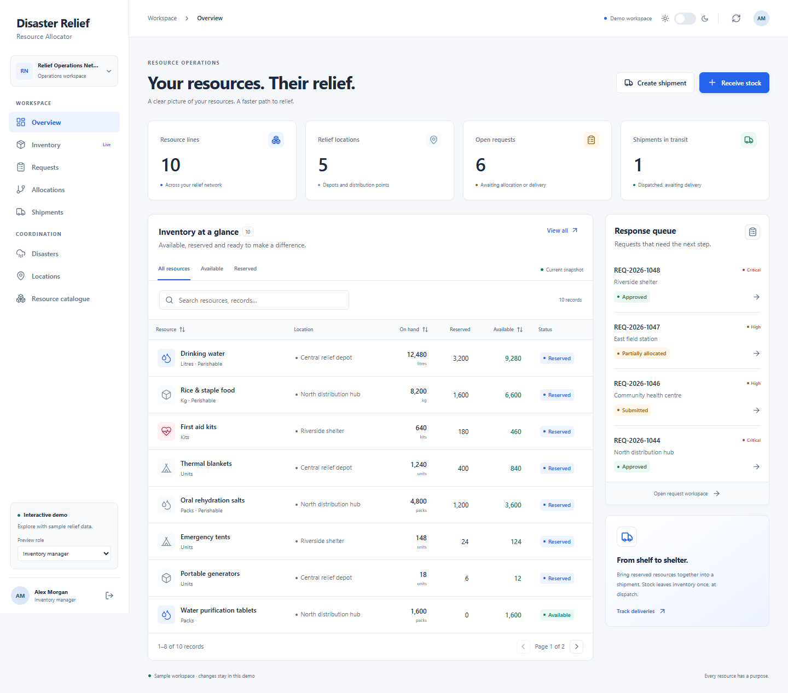

**[Take the guided tour](#guided-tour)** &nbsp;·&nbsp; **[Run the demo](#try-it-in-two-minutes)** &nbsp;·&nbsp; **[Tech stack](#tech-stack)** &nbsp;·&nbsp; **[Set up the full system](#getting-started)**

<sub>Actual application screenshots with sample data. The local demo runs without a backend or identity provider.</sub>

</div>

> **The idea:** know what is available, reserve it for an approved need, and follow it all the way to receipt. Allocation and delivery are tracked separately.

## Contents

- [Why this project?](#why-this-project)
- [Key features](#key-features)
- [Roles and responsibilities](#roles-and-responsibilities)
- [Try it in two minutes](#try-it-in-two-minutes)
- [Guided tour](#guided-tour)
- [A relief operation in practice](#a-relief-operation-in-practice)
- [Tech stack](#tech-stack)
- [System architecture](#system-architecture)
- [System design diagrams](#system-design-diagrams)
- [Security and consistency](#security-and-consistency)
- [Getting started](#getting-started)
- [Testing and CI](#testing-and-ci)
- [Project layout](#project-layout)
- [Current scope and deployment](#current-scope-and-deployment)
- [Documentation](#documentation)
- [Contributing](#contributing)

## Why this project?

Relief operations need more than a list of supplies. They need a consistent connection between reported needs, warehouse stock, operational decisions and delivery records.

This project brings those records into one workflow. It reserves stock before shipment, distinguishes allocation from delivery, enforces organization boundaries and records successful changes with trusted actor attribution.

> **Core principle:** a supply commitment is not a delivery. Stock is reserved during allocation, deducted once at dispatch, and recorded as delivered only after receipt is confirmed.

## Key features

| Capability | What the system supports |
| --- | --- |
| Disaster coordination | Create, activate and close disasters; associate affected locations |
| Resource inventory | Maintain a shared resource catalogue; receive and adjust organization-owned stock |
| Request lifecycle | Create drafts, add resource items, submit, approve or reject requests |
| Allocation | Automatically reserve matching available stock or reserve an exact quantity; retain allocation history |
| Shipment management | Group reserved allocations by destination; create, dispatch, deliver or cancel before dispatch |
| Organization administration | Provision organizations and issuer-bound users; manage local roles and active status |
| Secure access | Validate provider-issued JWTs and enforce backend roles, ownership and organization scope |
| Audit history | Search administrator-only records of successful administrative and relief operations |
| Operational workspace | Dashboard and searchable, paginated tables with saved light/dark themes |
| Interactive demo | Explore sample workflows in a clearly labelled, in-memory environment |
| Automated delivery checks | Backend/frontend checks, PostgreSQL migration verification and source-identified release candidates |

### Roles and responsibilities

| Role | Main responsibilities |
| --- | --- |
| `SYSTEM_ADMIN` | Manage organizations/users and audit history; perform authorized operations across organizations |
| `DISASTER_COORDINATOR` | Manage disasters, review requests, allocate resources and manage shipments |
| `INVENTORY_MANAGER` | Manage resource types and stock, allocate resources and manage shipments |
| `FIELD_AGENT` | Create and submit own requests, view organization-scoped progress and confirm delivery |
| `PARTNER_MANAGER` | Create locations and manage organization-scoped requests |
| `VIEWER` | Read permitted organization-scoped operational records |

Roles are stored in local profiles. JWT role claims do not grant application permissions. Field agents can edit/submit only their own requests; partner managers can manage their organization's requests. Organization checks and lifecycle rules apply in addition to role checks.

## Try it in two minutes

You only need **Node.js 24 and npm** to explore the interface.

```sh
git clone https://github.com/harsha160507/Disaster-relief-resource-allocator-.git
cd Disaster-relief-resource-allocator-/frontend
npm ci
npm run dev
```

Open the local URL printed by Vite, normally `http://127.0.0.1:5173`, and choose **Explore demo workspace**.

The sample environment includes ten resource types, five locations, two active disaster responses, requests at different stages and three shipments. Start as an **Inventory manager**, then use **Preview role** to explore the coordinator, field-agent and administrator views.

Demo changes live in memory and reset on reload. The demo role selector previews the interface; live access requires a provisioned identity and backend authorization. There is no hosted public demo linked here.

## Guided tour

**One request, from review to receipt.** Follow these steps in a fresh demo session; allow about five minutes. Every picture below comes from the application's local demo, using its real controls and sample records.

### 1. Enter the workspace

Choose **Explore demo workspace** on the welcome screen. The overview brings inventory balances, open requests and shipments in transit together.

<table>
  <tr>
    <td width="50%">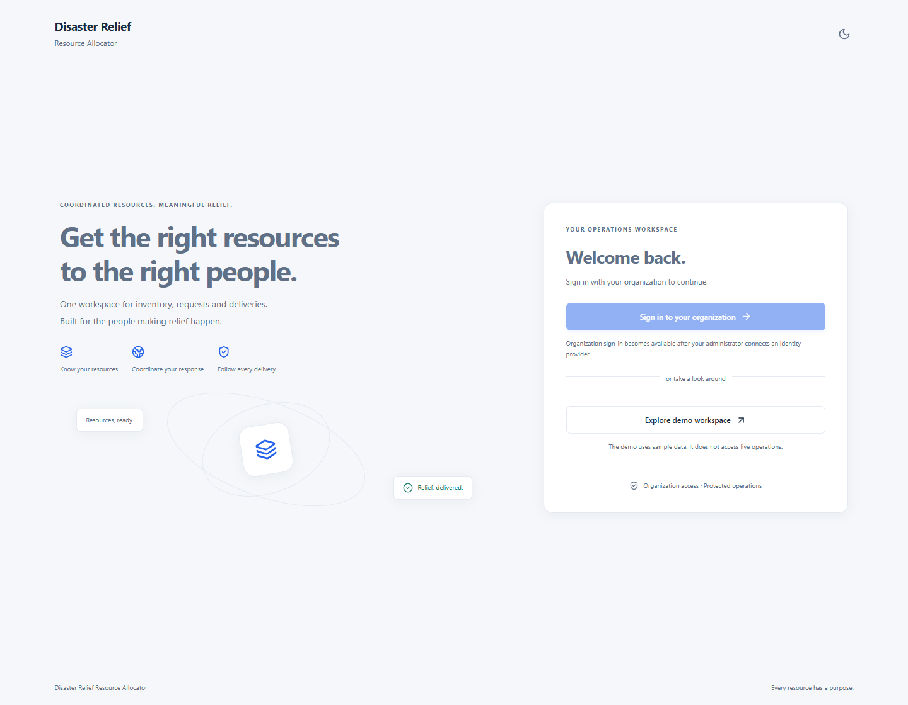<br><sub><b>Start here.</b> Explore sample operations without a live sign-in.</sub></td>
    <td width="50%"><br><sub><b>Get oriented.</b> Stock and requests share one operational view.</sub></td>
  </tr>
</table>

### 2. Read what is actually available

Open **Inventory**. Find **First aid kits** at **Riverside shelter**: **640 on hand**, **180 reserved**, **460 available**. These three quantities answer different questions; a reservation commits goods without removing them from the warehouse.

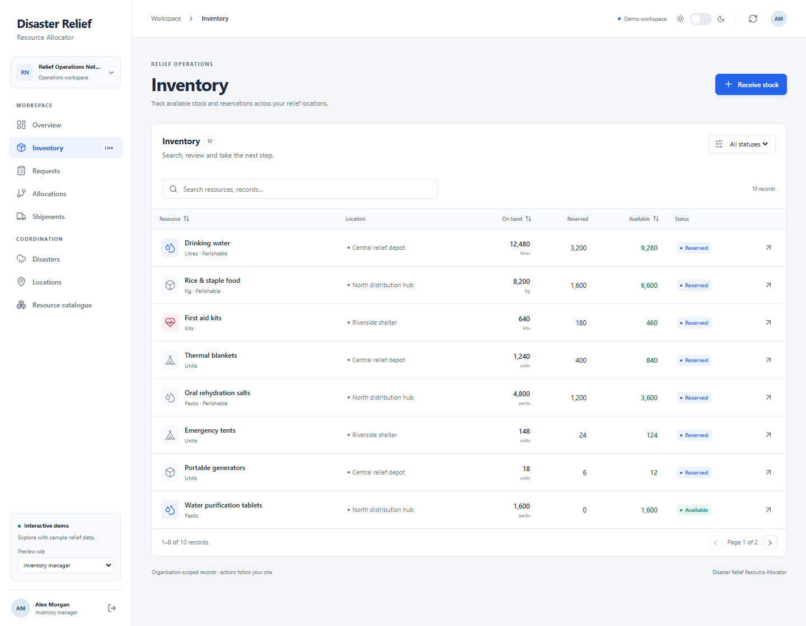

### 3. Review a field request

Change **Preview role** to **Disaster coordinator**, open **Requests**, and open **REQ-2026-1046**. It asks for **100 first aid kits** for **Community health centre**. Choose **Approve request**, then **Confirm**.

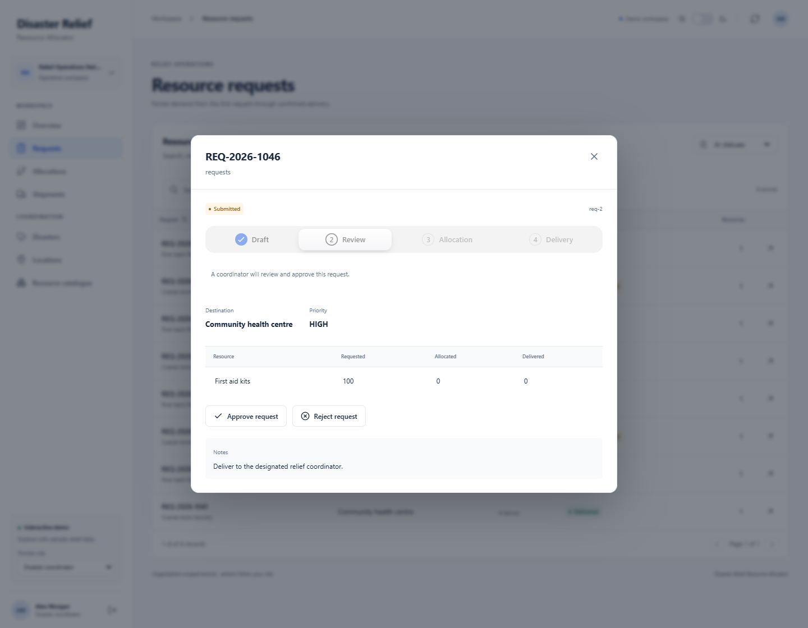

### 4. Reserve the supplies

Switch back to **Inventory manager**, reopen **Requests → REQ-2026-1046**, and choose **Allocate available stock → Confirm**.

The request becomes **Fully allocated**: **100 requested, 100 allocated, 0 delivered**. Physical stock is still **640**; reservations rise to **280**, leaving **360** available.

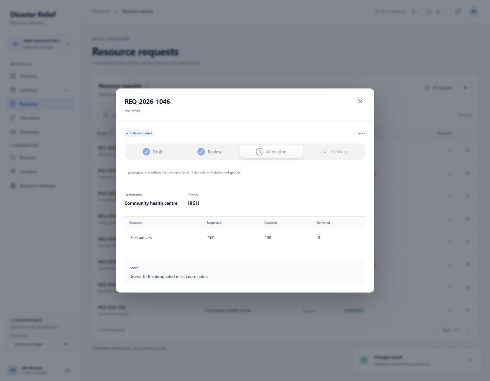

### 5. Build a shipment for that destination

Close the request, open **Shipments**, and choose **Create shipment**. Select **Community health centre** from the destination suggestions, enter **SHP-TOUR-001** as the tracking reference, and select the **100 First aid kits** allocation for **REQ-2026-1046**. Choose **Create shipment**.

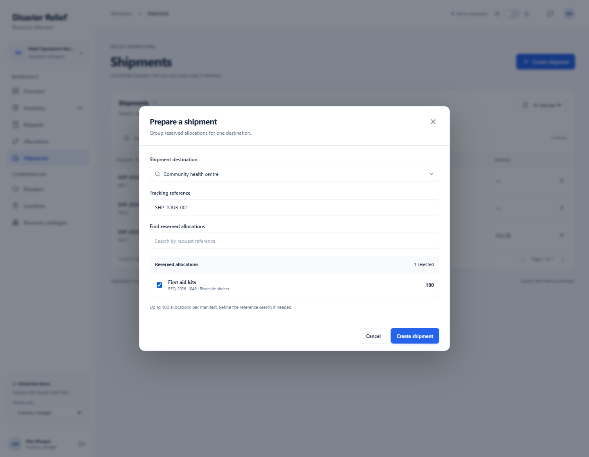

### 6. Dispatch, then confirm receipt

Open **SHP-TOUR-001** and choose **Dispatch shipment → Confirm**. The goods now leave warehouse stock. Once they arrive, choose **Confirm delivery → Confirm**.

<table>
  <tr>
    <td width="50%">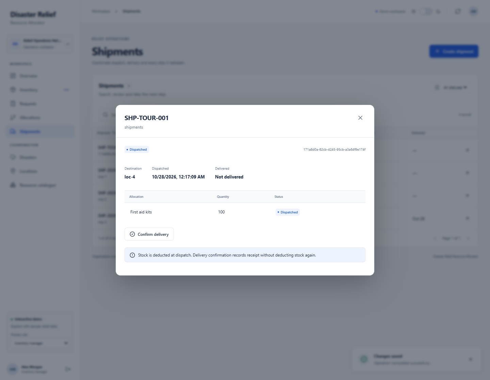<br><sub><b>Dispatched.</b> Stock has left the warehouse; receipt is still pending.</sub></td>
    <td width="50%">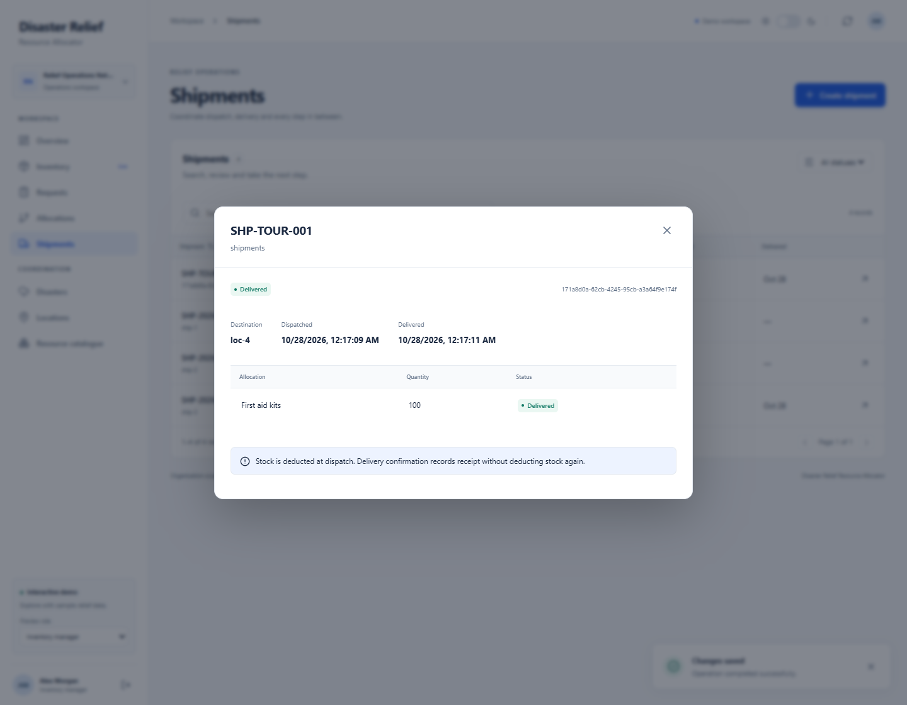<br><sub><b>Delivered.</b> Receipt is recorded without a second stock deduction.</sub></td>
  </tr>
</table>

### 7. Close the loop

Reopen **Requests → REQ-2026-1046**: all **100 kits are delivered**. In **Inventory**, First aid kits now show **540 on hand**, **180 reserved**, **360 available**.

<table>
  <tr>
    <td width="50%">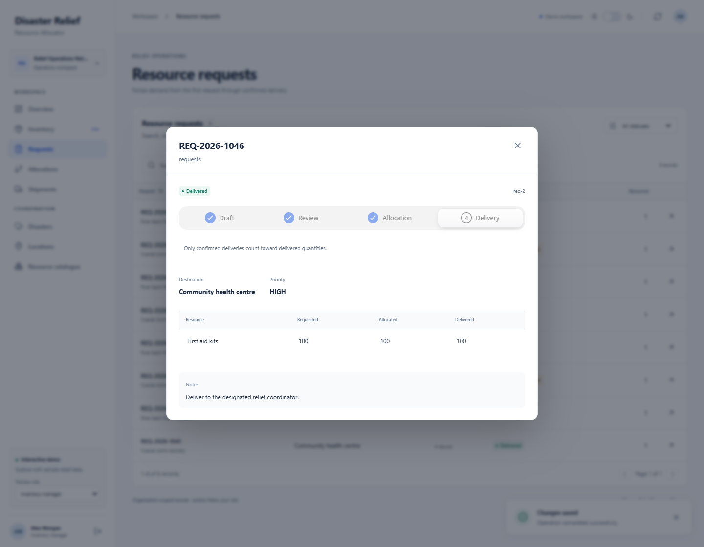<br><sub><b>Demand fulfilled.</b> The request records confirmed receipt.</sub></td>
    <td width="50%">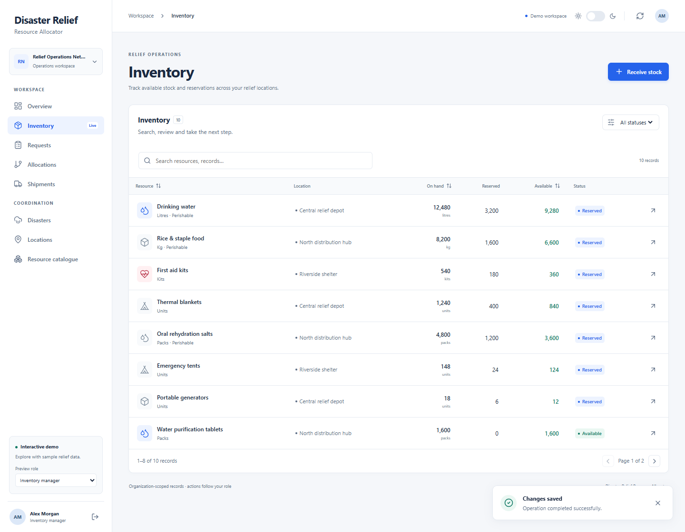<br><sub><b>Stock reconciled.</b> Existing reservations remain intact.</sub></td>
  </tr>
</table>

### 8. Make the workspace yours

Use the theme switch at the top right to try the dark interface. Your theme preference is saved locally. Reload to reset the demo records, or use **Exit demo** at the bottom of the sidebar to return to the welcome screen.

<details>
<summary><b>See the dark workspace</b></summary>

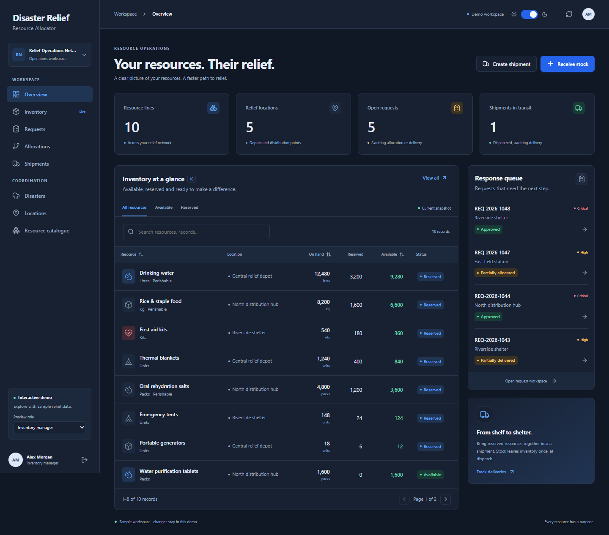

</details>

## A relief operation in practice

1. **Prepare:** register an organization, provision its users, create locations and resource types, and record warehouse stock.
2. **Identify need:** create and activate a disaster, associate affected locations, and submit an itemized request.
3. **Review:** a coordinator or administrator approves or rejects the request.
4. **Allocate:** reserve matching stock from the same organization. Automatic allocation can satisfy part of a request when stock is limited.
5. **Ship:** group unassigned reservations for one destination into a shipment.
6. **Dispatch:** deduct physical and reserved quantities once.
7. **Confirm delivery:** update delivered quantities and request progress.
8. **Review history:** inspect allocation records and administrator-only audit events.

### Stock accounting that follows the workflow

**Available quantity = physical quantity − reserved quantity**

For a warehouse starting with **100 food kits** and a request for **60 kits**:

| Stage | Physical | Reserved | Available | Delivered to destination |
| --- | ---: | ---: | ---: | ---: |
| Stock received | 100 | 0 | 100 | 0 |
| Allocation reserved | 100 | 60 | 40 | 0 |
| Shipment created | 100 | 60 | 40 | 0 |
| Shipment dispatched | 40 | 0 | 40 | 0 |
| Delivery confirmed | 40 | 0 | 40 | 60 |

Cancelling a shipment **before dispatch** releases its reservations and allocated demand without deducting physical stock. Delivery does not deduct stock a second time.

`FULFILLED` means **fully allocated**; actual receipt is represented separately by `PARTIALLY_DELIVERED` and `DELIVERED`.

## Tech stack

Versions below come from the checked-in [Maven configuration](backend/pom.xml) and [frontend lockfile](frontend/package-lock.json).

| Layer | Technology | What it does here |
| --- | --- | --- |
| Backend language | **Java 25** | Domain logic, transactional services and typed API models |
| API framework | **Spring Boot 4.1.1 · Web MVC · Bean Validation** | REST endpoints, input validation and structured errors |
| Authentication and access | **Spring Security OAuth2 Resource Server · OIDC** | Validates provider JWTs; applies local roles and organization scope |
| Data access | **Spring Data JPA / Hibernate** | Entity persistence, locking and version checks |
| Database | **PostgreSQL**; CI uses **17** | Stores operational records and audit history |
| Schema migrations | **Flyway** | Versioned database changes before Hibernate validation |
| Frontend | **React 19.3.1 · TypeScript 5.9.3** | Operational screens, forms and role-aware navigation |
| Build tooling | **Vite 8.3.5 · Maven Wrapper** | Frontend bundling and repeatable backend builds |
| Browser identity client | **oidc-client-ts 3.5.0** | Authorization code flow with PKCE |
| Interface | **Motion 12.43.0 · Lucide · Hugeicons · CSS** | Interactive controls, icons, light/dark themes and transitions |
| Verification | **Spring Boot test stack · H2 · PostgreSQL integration checks · Vitest 5.0.5** | Backend regressions, real database behavior and frontend tests |
| Code style and delivery | **Prettier 3.9.10 · GitHub Actions · Python release tooling** | Formatting, automated checks and packaged release candidates |

The frontend demo uses in-memory sample records. The live system uses PostgreSQL and an external identity provider; the demo is not a substitute for backend security or database checks.

## System architecture

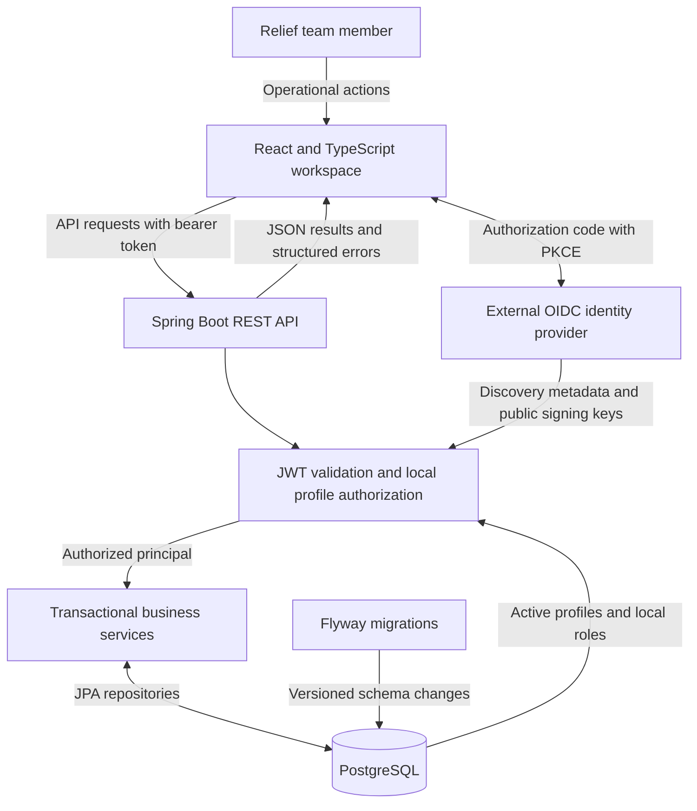

## System design diagrams

Explore the [data-flow and use-case diagrams](docs/system-design.md) for a closer look at the implementation:

- [Level 0: system context](docs/system-design.md#level-0--system-context)
- [Level 1: application processes](docs/system-design.md#level-1--major-application-processes)
- [Level 2: resource allocation](docs/system-design.md#level-2--decomposition-of-40-allocate-resources)
- [Use cases by role](docs/system-design.md#use-case-diagrams)

The diagrams retain the detailed process boundaries, audit behavior and authorization notes.

## Security and consistency

- **Trusted identity:** JWT signature, issuer, audience and time claims are validated; each request reloads the active local profile and roles.
- **Organization isolation:** request destinations, requesters and allocated stock must have compatible organization ownership.
- **Concurrency protection:** transactions, row locks and entity versions protect stock and lifecycle changes.
- **Atomic accountability:** successful business changes and audit events share one transaction.
- **Protected history:** PostgreSQL rejects audit updates, deletes and truncation. Runtime database privileges must preserve these protections; a database owner can alter them, so this is not cryptographic tamper evidence.
- **Explicit failures:** invalid input, missing records, conflicts, denied access and business-rule violations produce structured API errors.
- **Safe schema evolution:** Flyway migrations run before Hibernate validation; applied migrations remain unchanged and Flyway clean is disabled.

## Getting started

### Prerequisites

- JDK **25 or later** and the checked-in Maven wrapper.
- Node.js **24** and npm for the frontend.
- A PostgreSQL database; CI uses PostgreSQL 17.
- An external OIDC/OAuth2 provider and provisioned local profiles for live authenticated access.

### 1. Configure PostgreSQL

Provision an empty database/schema, then supply these backend environment variables:

```text
DB_URL=jdbc:postgresql://<host>:<port>/<database>
DB_USERNAME=<database-user>
DB_PASSWORD=<database-password>
```

Use environment configuration or a secrets manager. Never commit real credentials. Flyway creates/upgrades the application schema; it does not create the database itself.

See the [database setup guide](docs/database-setup.md) for local Docker Compose, existing servers, migration/runtime account separation and safe upgrades.

### 2. Configure live authentication

```text
SECURITY_OAUTH2_ISSUER_URI=https://<provider>/<issuer>
SECURITY_OAUTH2_AUDIENCE=<api-audience>
```

Follow [identity and administration setup](docs/identity-and-administration.md) to bootstrap the first administrator once and provision organizations/users. Without a configured issuer, protected endpoints remain inaccessible; database setup alone does not create users or sessions.

### 3. Start the backend

From the repository root:

```sh
cd backend
./mvnw spring-boot:run
```

Use `mvnw.cmd` on Windows. Production keeps `spring.jpa.hibernate.ddl-auto=validate`; future schema changes require new versioned migrations.

### 4. Start the frontend

In another terminal, from the repository root:

```sh
cd frontend
npm ci
npm run dev
```

For live sign-in, copy `frontend/.env.example` to an untracked `frontend/.env.local` and configure `VITE_OIDC_AUTHORITY`, `VITE_OIDC_CLIENT_ID`, `VITE_OIDC_SCOPE` and, if required by the provider, `VITE_OIDC_AUDIENCE`.

Register a public browser client using authorization code with PKCE and the exact `/auth/callback` redirect. Frontend settings are public build-time values: never include client secrets.

The development server normally opens at `http://127.0.0.1:5173` and proxies `/api` to `http://127.0.0.1:8080`. See [frontend setup](docs/frontend-setup.md) for full configuration.

### Explore without a live backend

Follow [Try it in two minutes](#try-it-in-two-minutes), then use the [guided tour](#guided-tour) to walk through a complete sample delivery.

## Testing and CI

| Check | Command / behavior |
| --- | --- |
| Backend regression suite | From `backend/`: `./mvnw test` |
| Real PostgreSQL integration checks | From `backend/`: `./mvnw -Ppostgres-it verify` |
| Frontend tests | From `frontend/`: `npm test` |
| Frontend formatting | From `frontend/`: `npm run format:check` |
| Production frontend build | From `frontend/`: `npm run build` |
| Release tooling tests | From repository root: `python3 -m unittest discover -s scripts/tests -v` |

Normal backend tests use isolated **H2** databases with Flyway disabled. PostgreSQL checks require `PG_TEST_URL`, `PG_TEST_USERNAME` and `PG_TEST_PASSWORD` for a **dedicated test database**. They verify real migrations, constraints, concurrency, audit protections and persistence; an H2 pass alone does not validate PostgreSQL behavior.

GitHub Actions runs backend/PostgreSQL checks, packaged-JAR startup/authentication smoke checks, frontend formatting/tests/dependency audit/build, and release-tooling tests. Successful main/manual runs produce source-identified release candidates with a manifest and SHA-256 checksums. The CI badge links to actual run status.

## Project layout

| Path | Contents |
| --- | --- |
| `backend/` | Spring Boot API, domain model, services, repositories, migrations and tests |
| `frontend/` | React/TypeScript workspace, OIDC integration and demo experience |
| `docs/` | System design, screenshot tour, database, identity, audit, shipment, frontend and release guides |
| `scripts/` | Release packaging, startup smoke checks and tooling tests |
| `deploy/` | Deployment configuration examples |
| `.github/workflows/` | Automated CI and release-candidate workflow |

## Current scope and deployment

The repository includes the backend, desktop frontend and automated CI/release-candidate pipeline. Production acceptance still requires the target identity provider, HTTPS hosting, a same-origin API reverse proxy, database account configuration, backup/restore rehearsal and operational monitoring.

The application does not currently implement geographic route optimization, a global priority-based allocation optimizer, or post-dispatch returns/loss reconciliation. Audit capture covers successful application-service changes; it does not automatically capture direct SQL edits, read access or identity-provider events.

CI does not automatically deploy the application or publish a public release. Use the [release-readiness guide](docs/release-readiness.md) for acceptance and rollback.

## Documentation

| Guide | Covers |
| --- | --- |
| [Database setup and migrations](docs/database-setup.md) | PostgreSQL provisioning, Flyway migrations, upgrades and integration tests |
| [Identity and administration](docs/identity-and-administration.md) | OIDC/JWT configuration, bootstrap, roles and organization access |
| [Audit history](docs/audit-history.md) | Event coverage, attribution, filters and database protections |
| [Shipment workflows](docs/shipment-workflows.md) | Stock accounting, manifests, transitions and permissions |
| [Frontend setup](docs/frontend-setup.md) | Local development, live sign-in, demo and production hosting |
| [Component integration](docs/frontend-components.md) | Supplied UI components and integration choices |
| [CI and release readiness](docs/release-readiness.md) | Automated checks, candidate artifacts, acceptance and rollback |

## Contributing

Useful contributions include clearer workflow guidance, accessibility improvements, stronger allocation/concurrency tests and fixes for reproducible bugs.

1. Open an [issue](https://github.com/harsha160507/Disaster-relief-resource-allocator-/issues) describing the problem or proposed change.
2. Keep a pull request focused and explain the behavior before and after your change.
3. Run the relevant [checks](#testing-and-ci). Include screenshots for interface changes and refresh tour images when the workflow changes.

See [screenshot capture notes](docs/img/README.md) before updating the visual tour.

---

<div align="center">

**From shelf to shelter. With a record at every step.**

Built by [Harshavardhan K](https://github.com/harsha160507)

If this project is useful to you, consider giving it a ⭐ or sharing an improvement.

[Back to top](#disaster-relief-resource-allocator) &nbsp;·&nbsp; [Report an issue](https://github.com/harsha160507/Disaster-relief-resource-allocator-/issues) &nbsp;·&nbsp; [Explore the code](https://github.com/harsha160507/Disaster-relief-resource-allocator-)

</div>
