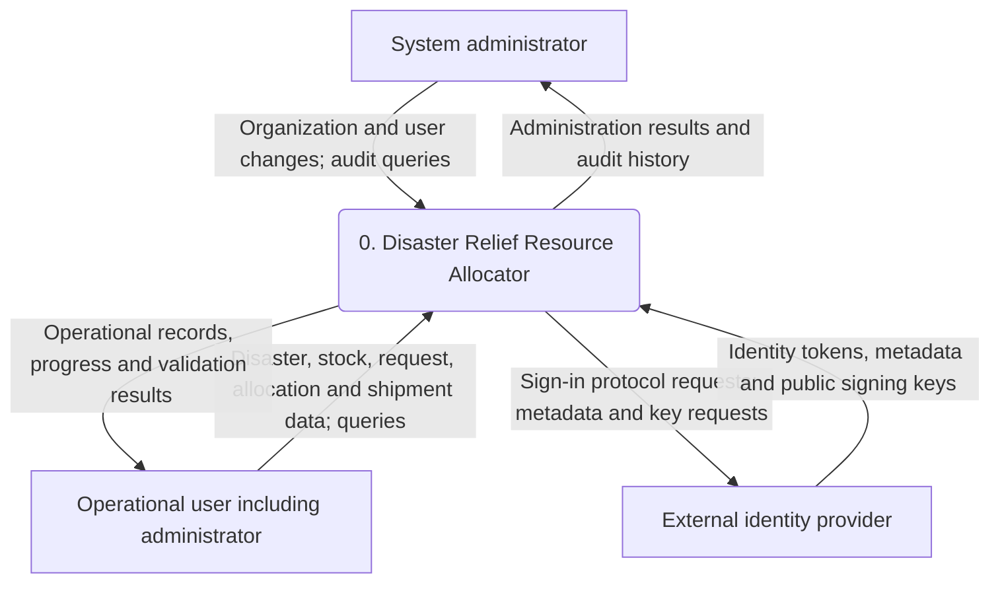
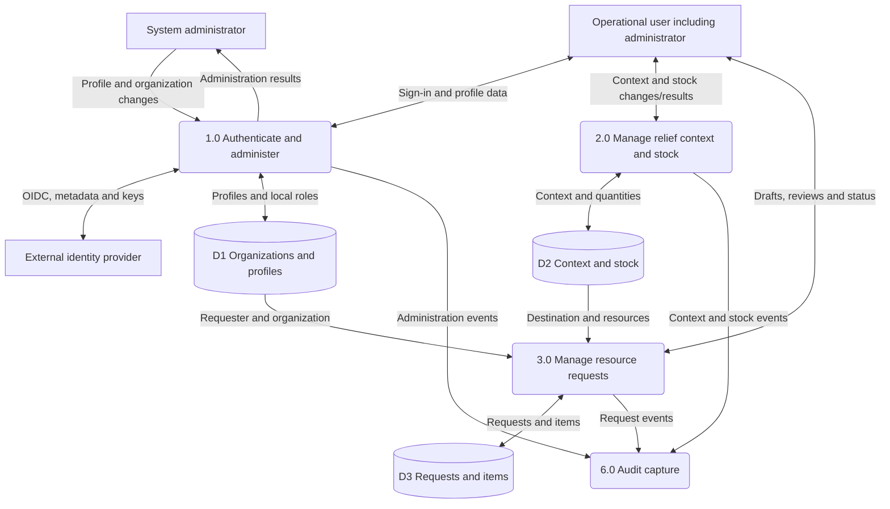
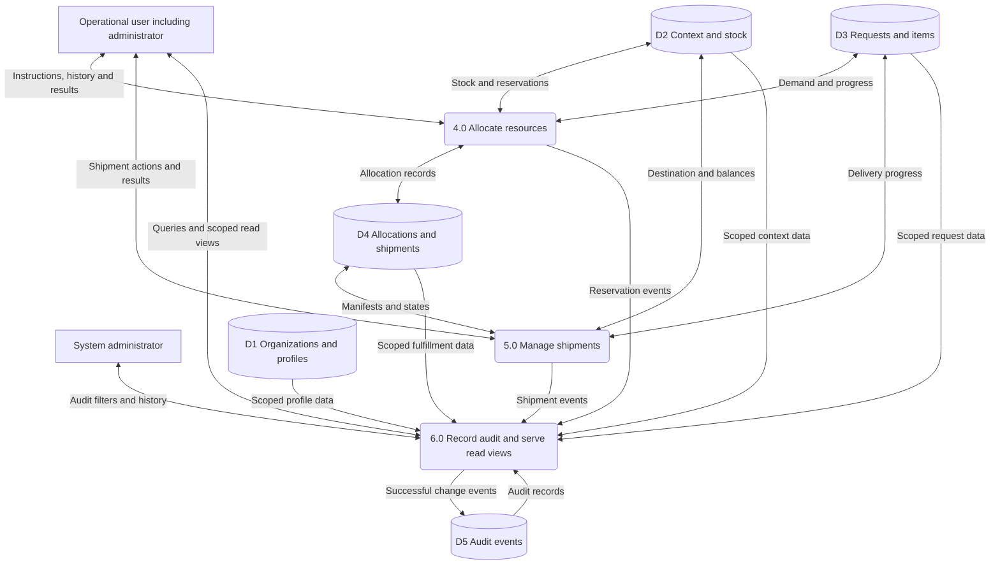
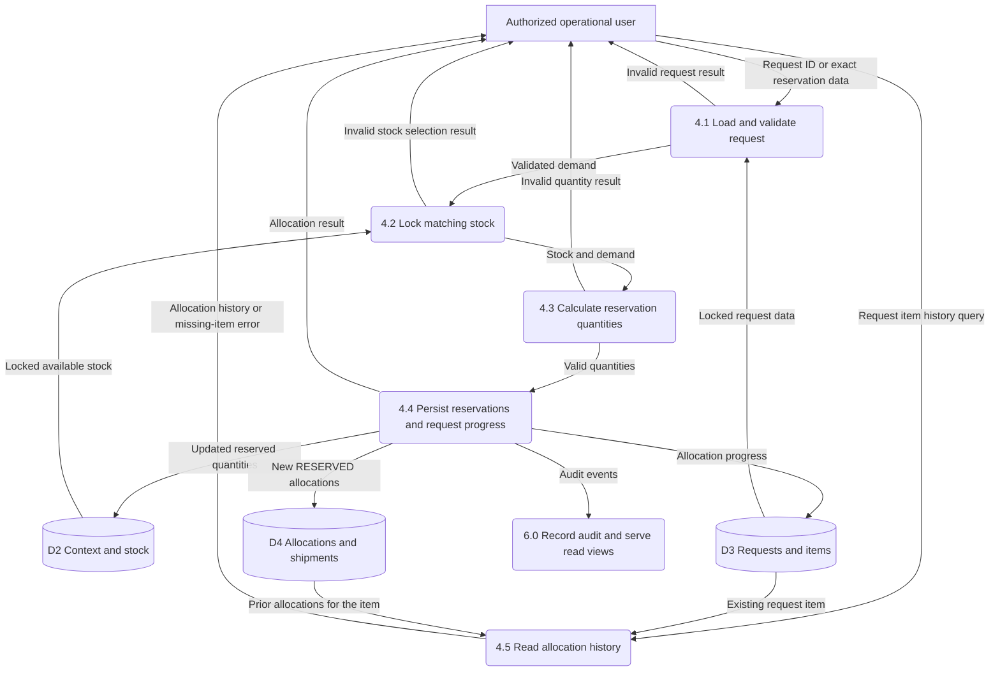
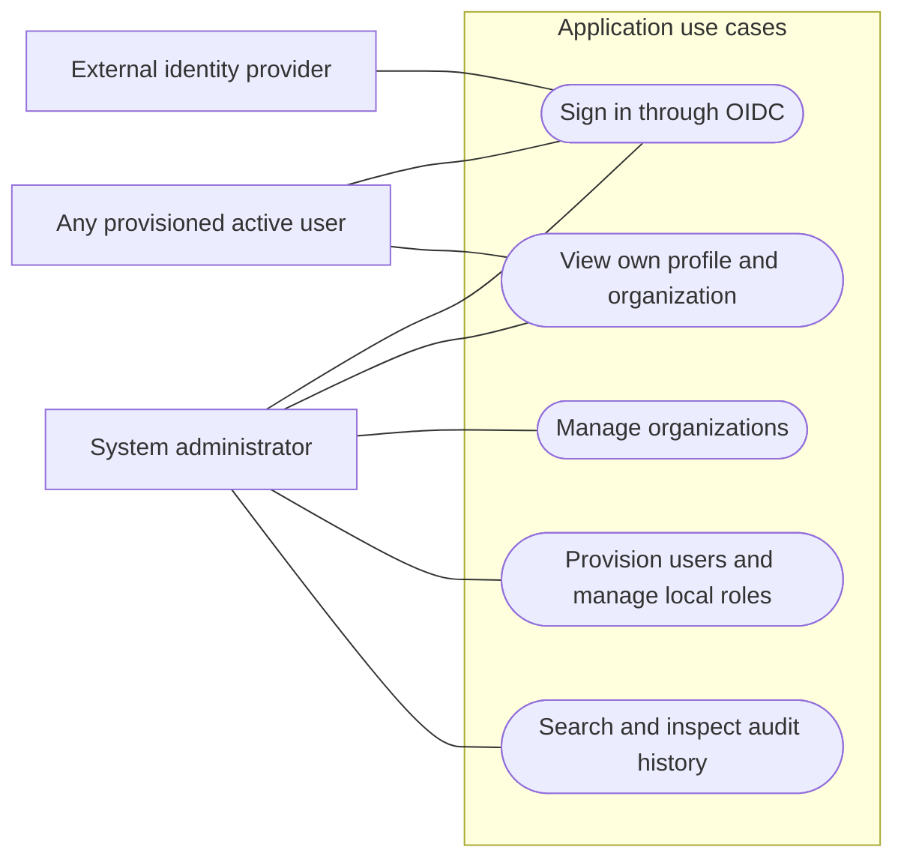
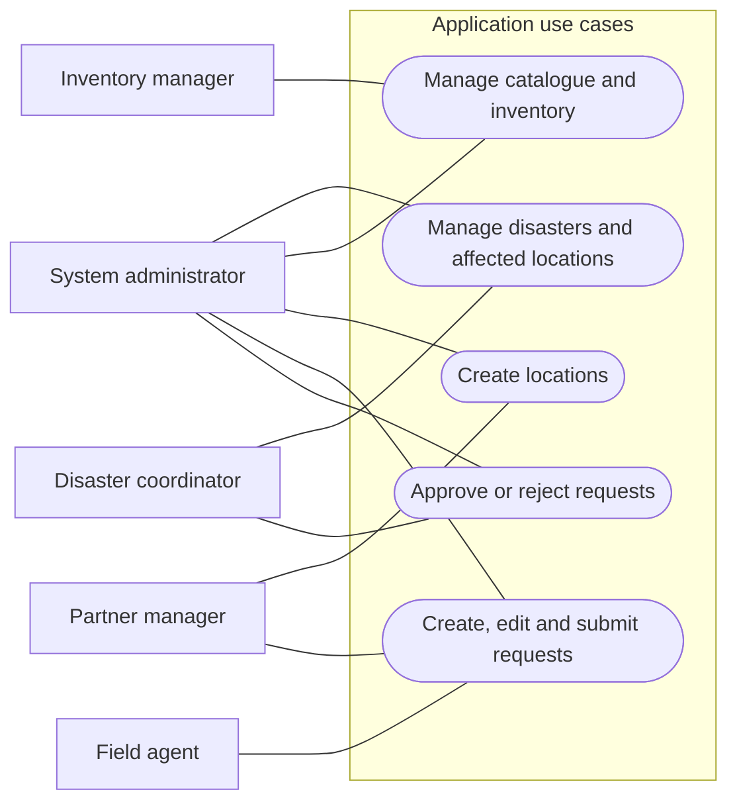
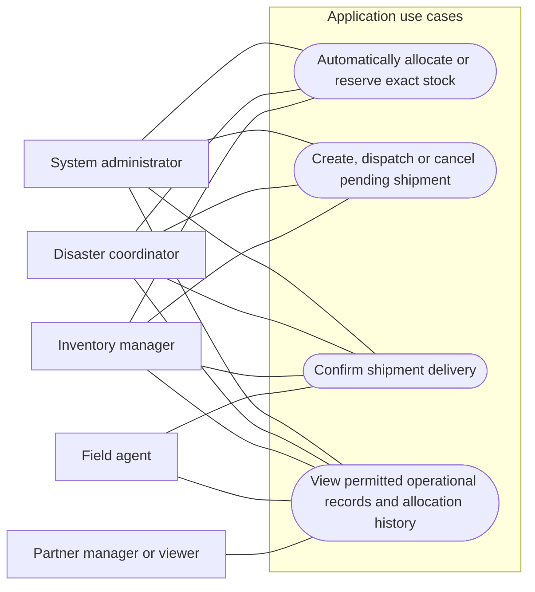

# System design

[← Back to the README](../README.md#system-design-diagrams)

Detailed data-flow and actor/use-case views for the Disaster Relief Resource Allocator.

## Data flow diagrams

These are **logical DFDs**, using Mermaid for GitHub-native rendering. Rectangles represent external entities, rounded nodes represent processes, cylinders represent logical data stores, and labelled arrows represent data. Store groups are tables within the same PostgreSQL database, not separate databases. Arrows describe information movement, not the movement of physical goods.

### Level 0 — system context

The entire application is one process. Relief staff includes coordinators, inventory managers, field agents, partner managers and viewers; each action is subject to that user's permissions.

### Level 1 — major application processes

**Level 1A — access, preparation and demand.**

The context process decomposes into six responsibilities, shown in two connected views. P2 groups disaster/location/catalogue and inventory operations; P6 groups read views and audit capture. Shared authorization applies before operational processes. Administrator operations use the same business processes with cross-organization scope where permitted.

**Level 1B — allocation, shipment and visibility.** P6 and D1–D3 are the same logical processes/stores referenced above; they are repeated for readability.

Administrators also participate through the operational-user entity. P6's audit writes occur **inside the originating business transaction**, not through an asynchronous event pipeline. An audit append failure rolls back the business change.

### Level 2 — decomposition of 4.0 Allocate resources

This view expands P4 while retaining its Level 1 boundaries: allocation instructions/results, stock, requests, allocations and audit events. Access checks happen at the HTTP boundary; services lock the request and inventory before changing quantities.

Automatic allocation reserves **min(remaining need, available stock)** from matching inventory in the destination's organization, ordered by inventory UUID. It can leave demand partially allocated. Exact reservations reject nonpositive quantities, mismatched resources, cross-organization stock, excess demand or insufficient availability. This is stock-matching allocation; the implementation does not optimize geographic routes or globally rank competing requests.

## Use case diagrams

These diagrams use **UML-style actor/use-case associations expressed as Mermaid flowcharts**: external rectangles are actors, oval nodes are use cases, and subgraphs define the application boundary. Associations show participation, not execution order. The views are split for readability.

### Administration and access

The application binds provider identities to local profiles; it does not issue passwords or provide public self-registration. Global administrators have no organization membership.

### Disaster, inventory and request operations

### Allocation, shipment and operational visibility

Operational reads remain subject to endpoint-specific permissions and organization scope. For example, inventory/catalogue APIs are restricted to administrators and inventory managers; membership does not grant unrestricted access to every dataset. The API permits coordinators and inventory managers to reserve exact quantities, although the current frontend exposes exact reservation to inventory managers.

